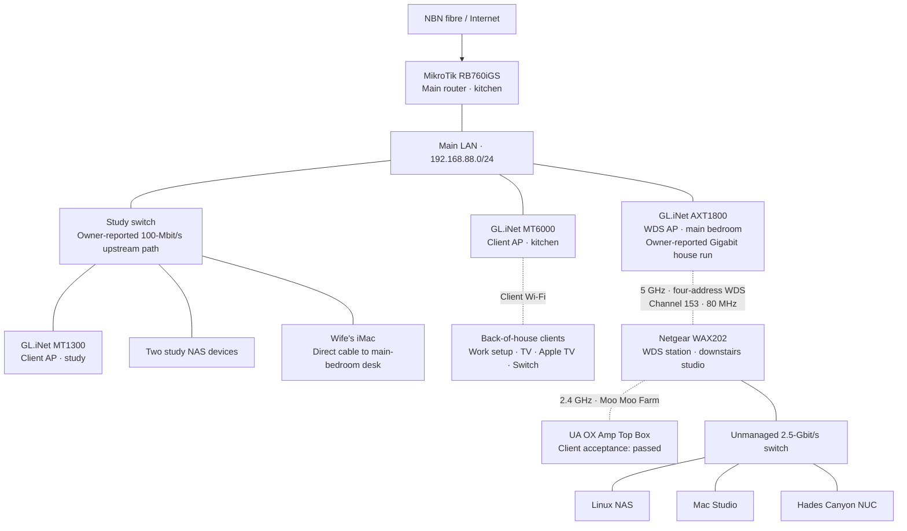

# Network topology

Updated: 2026-10-18 (Australia/Sydney).
This is the retained operational layout. The owner accepted it on 2026-10-17.
AP means access point. WDS means wireless distribution system.
LAN means local area network.
Placement and performance use the owner's 2026-10-16 report. Software and
management state use the recorded audits and applied-change evidence below.
The 2026-10-18 OX Wi-Fi addition uses fresh WAX202 state. Other unchanged
entries retain their dated evidence.

## Whole network

Solid lines show logical Ethernet paths. Dashed lines show wireless paths.
This is not an exact physical port map. Post-swap cable ports, switch uplinks,
and client associations have not been independently collected.
The study NAS-to-iMac path does not need the kitchen uplink.

The owner reports slow house runs: study about 100 Mbit/s, studio about
10 Mbit/s, and main bedroom 1 Gbit/s. These are reported path limits, not
intrinsic socket ratings. The fault location is unverified. The studio wall
path is not the uplink; the working WDS bridge bypasses it.
In-wall repair and a cable across the bedroom doorway are not current options.

## Critical forwarding path

The 2026-10-06 passing capture verified this AXT1800 transmit path. The WAX202
upgrade retained its bridge role. Interface names can change after an upgrade
or reassociation. Discover them before a later diagnostic capture.
The bridge keeps one Layer 2 LAN. No routing or network address translation
is intended across WDS. Preserve the working pair and channel 153 / 80 MHz.

## Device inventory

| Device | Retained role | Management / host IPv4 | Latest recorded software |
|---|---|---|---|
| MikroTik RB760iGS | Main router, kitchen | `192.168.88.1` | RouterOS and RouterBOOT 7.23.8; long-term channel |
| GL.iNet MT6000 | Kitchen client AP | `192.168.88.2` | GL.iNet 4.11.0 release3; local web hostname allowlist entry |
| GL.iNet MT1300 | Study client AP | `192.168.88.3` | GL.iNet 4.3.25; local NTP resolver-tracking patch |
| Netgear WAX202 | Studio WDS station and 2.4 GHz client AP | `192.168.88.4` | OpenWrt 25.12.5 |
| GL.iNet AXT1800 | Bedroom WDS AP | `192.168.88.5` | OpenWrt 25.12.5 |
| Linux NAS | Studio server | `192.168.88.6` | Host configuration under `host/` |
| Apple TV | Wi-Fi client and Tailscale remote-access path | `192.168.88.8` | Client software not audited directly |
| Mac Studio | Studio workstation | `192.168.88.121` in the older inventory | Current client address not rechecked |
| Hades Canyon NUC | Studio computer | `192.168.88.139` in the older inventory | Current client address not rechecked |

Software sources: [runtime audit](runtime-audit-2026-10-09.md),
[MikroTik upgrade](changes/mikrotik-firmware.md),
[WAX202 upgrade](changes/wax202-firmware.md),
[MT6000 upgrade](changes/mt6000-firmware.md), and
[MT1300 time repair](changes/mt1300-time.md).
NTP means Network Time Protocol. Review the local MT1300 patch after any upgrade.

On 2026-10-18, the owner approved `Moo Moo Farm` on WAX202's separate
2.4 GHz radio for the studio OX. It bridges to the existing LAN with WPA2/AES
and no client isolation. Technical checks passed. OX connection and app control passed by owner report.
The WDS connection stayed associated. See [the OX Wi-Fi record](changes/wax202-ox-wifi.md).

## Addressing and naming

The recorded Dynamic Host Configuration Protocol (DHCP) pool is `.100–.199`.
AXT1800 moved from `.115` to static `.5` outside that pool on 2026-10-09.
The Apple TV `.8` reservation now matches its Wi-Fi interface.
Do not infer every device's allocation method from this address inventory.

MikroTik supplies explicit `.lan` records for all five network devices.
Air and workspace SSH aliases are `mikrotik`, `mt6000`, `mt1300`, `wax202`,
and `axt1800`. Their host selection uses DNS. The owner verified all five
Air aliases after migration. See [the address/DNS record](changes/protect-axt-address.md).
Retain current `.lan` names for this baseline. Migration to `home.arpa` is
deferred and has not occurred. Revisit it only as a separate naming change.

## Accepted performance and review trigger

The owner used the swapped layout for several days. Internet tests reached at
least 350 Mbit/s at the back of the house and above 300 Mbit/s in the downstairs
toilet. The bedroom reached about 85 Mbit/s through MT1300. Kitchen MT6000
reached below 10 Mbit/s in the bedroom and about 60 Mbit/s on a studio phone.
The phone could not see the study MT1300 network.
These are owner-reported results, without raw logs, test directions, or bands.

On 2026-10-17, the owner accepted these limits and retained the layout.
Hardware purchases, AP consolidation, and further radio tuning are deferred.
Reopen coverage work if normal use becomes inadequate or requirements change.
The earlier wired tests demonstrated WDS throughput above 600 Mbit/s in both
directions. The 85-Mbit/s Internet result is consistent with the study upstream
limit; it does not establish an MT1300 radio capacity limit.

Evidence: the investigation [facts and performance records](https://github.com/volo1st/wds-arp-discovery-debug/blob/master/note.md)
and [accepted plan](https://github.com/volo1st/wds-arp-discovery-debug/blob/master/plan.md).
The source documents and performance logs currently include uncommitted updates
in the local investigation workspace. Their local files are authoritative until
publication. Audit implementation and recovery gates remain solely in
[work package 12](../intial-plan-after-audit.md#work-package-12-network-documentation-and-recovery).
